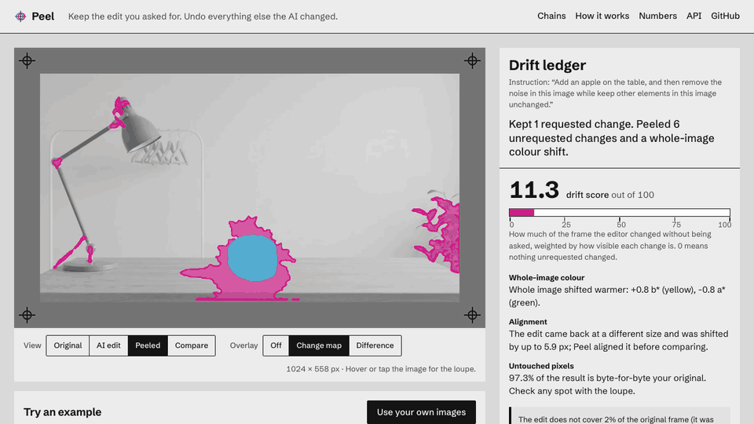
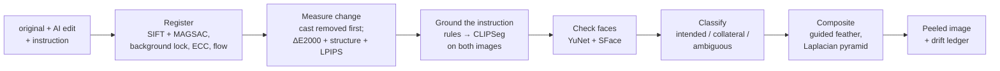

# Peel

**Keep the edit. Peel the drift.**

Peel takes an original image, the AI-edited version and the instruction, and returns a composite
that keeps the change you asked for and restores every other pixel to your original, byte for
byte. It also returns a drift ledger: every unrequested change, located, typed and measured, in
plain words.



| | |
| --- | --- |
| Web app | https://peel-rahulgunwanistudy-5466s-projects.vercel.app |
| API | see [Deployment](#deployment) |
| Built for | Banana Hacks 2026 |

## The problem

Instruction-based image editors (Nano Banana / Gemini image models, GPT Image) regenerate the whole
frame on every edit. You ask for one change and get several: the framing shifts, a face is
re-rendered, texture softens, the colour balance moves. Across chained edits the damage compounds,
and the usual quality metrics do not notice.

- [Banana100](https://arxiv.org/abs/2604.03400) (Tang et al., CVPR 2026 Workshops) documents the
  accumulation over 100 chained Nano Banana Pro edits and shows that popular no-reference quality
  metrics fail to flag it.
- A reviewer asked for a different edit and reported that the model
  ["trimmed my beard and gave me a sunburn"](https://www.androidauthority.com/google-nano-banana-hands-on-3596483) (Android Authority).
- Photoshop users report that the Gemini result
  [changes position and face details](https://community.adobe.com/t5/photoshop-beta-discussions/gemini-2-5-image-distored/m-p/15541734) (Adobe Community).

People work around it by hand-masking and compositing in Photoshop. Peel does that automatically,
and tells you what it found.

## What it does

1. **A composite.** The requested change is kept; everything else is the original. Outside the kept
   region the output is bit-identical to the input, and you can check that anywhere with the loupe.
2. **A drift ledger.** A drift score, the whole-image colour shift, the alignment that was needed,
   and one sentence per changed region: "The face on the left was re-rendered as a different-looking
   person (identity distance 0.47)." Any region can be flipped between keep and peel.
3. **Chain mode.** Each new edit is peeled against the previous peeled frame, so edit 20 still has
   the background of edit 0.

## How it works



No generative model is involved and no GPU is needed. Every pixel of the result comes from your
original or from the edit you already have. The full design, including the decisions that are not
obvious, is in [docs/architecture.md](docs/architecture.md).

### How this differs from diff-merge nodes

The closest existing tools are ComfyUI nodes such as
[KleinEditComposite](https://www.runcomfy.com/comfyui-nodes/comfyui-klein-edit-composite) and
[flux-kontext-diff-merge](https://comfy.icu/extension/xxxxxxxxxxxc__flux-kontext-diff-merge). They
align the two images and composite every region whose pixel difference exceeds a threshold. That
keeps *everything* that changed: a re-rendered face or a relit logo is pasted in as if it had been
requested. And they only exist inside ComfyUI.

Peel adds the part that decides: **instruction-grounded intended-versus-collateral classification**,
an **identity lock for faces**, **separation of the whole-image colour cast**, **chain anchoring**, a
**measured ledger**, and a product anyone can use (web, API, n8n). The ablation table below is the
evidence for each of those parts.

## Numbers

Every number here is produced by code in this repository (`make eval`) and written to
`eval/results/*.json`. This block is generated by `python -m eval.report`.

<!-- BEGIN NUMBERS -->
- Not measured yet. Run `make eval`.
<!-- END NUMBERS -->

## Run it locally

Requirements: Python 3.11, [uv](https://docs.astral.sh/uv/), Node 22.

```bash
make setup   # venv + npm install
make dev     # API on http://127.0.0.1:7860, web on http://127.0.0.1:5173
```

Command line:

```bash
.venv/bin/peel original.png edited.png "Add an apple on the table" -o out/
```

Other targets: `make test`, `make lint`, `make eval`, `make examples`, `make openapi`.
The first run downloads about 900 MB of model weights.

## API

```bash
curl -s $PEEL_API/v1/peel \
  -F original=@original.png -F edited=@edited.png \
  -F 'instruction=Make the jacket red' | jq '.ledger.headline, .ledger.drift_score'
```

| Endpoint | Purpose |
| --- | --- |
| `POST /v1/peel` | Peel one edit; returns ledger, timings and image URLs. |
| `POST /v1/peel/jobs`, `GET /v1/jobs/{id}/events` | Same, with stage progress over Server-Sent Events. |
| `POST /v1/recomposite` | Flip regions between keep and revert without re-analysing. |
| `POST /v1/chain` | A sequence of chained edits with a drift curve. |
| `POST /v1/edit` | Edit with Nano Banana server-side (needs `GEMINI_API_KEY`; otherwise `EDIT_UNAVAILABLE`). |
| `GET /v1/examples` | Curated pairs with precomputed results. |
| `GET /healthz`, `/docs` | Status and interactive OpenAPI docs. |

Errors are `{"error": {"code", "message", "request_id"}}` with messages written for people, for
example `NOT_SAME_SCENE`: "These look like two different photos. Peel compares an image with its
edited version." Images are held in memory for 30 minutes and never written to disk.

## n8n

[`integrations/n8n/peel-gate.workflow.json`](integrations/n8n/peel-gate.workflow.json) is an
importable workflow: form → Gemini image edit → Peel → gate on the drift score. Edits that leave
the rest of the photo alone pass; the others are replaced by Peel's repaired image and the ledger
summary is posted to chat. Setup notes are in [integrations/n8n](integrations/n8n/README.md).

## Deployment

- **Web**: Vercel, static build of `web/`, redeployed on every push to `main`. The first view is
  served from assets bundled with the build, so it does not depend on the API being awake.
- **API**: `deploy/Dockerfile` builds the API with all model weights baked in and also serves the
  same static web build at `/`. `python deploy/deploy_space.py <user>/<space>` pushes it to a
  Hugging Face Space (Docker SDK, port 7860).

## Limitations

- **Vague instructions.** "Make it better" names nothing to locate. Peel then keeps the strongest
  change, flags it, and says so; the region switches are the fallback.
- **Whole-image instructions** ("make it night", "watercolour style") change every pixel by design.
  Peel keeps the edit and only locks faces and text; nothing is bit-identical in that mode.
- **Crops and big reframings.** Where the edit does not cover the original frame, those pixels come
  from the original and the ledger says how much.
- **Featureless scenes.** On plain sky or sand a small shift cannot be measured. Peel then assumes
  the edit did not move, reports medium confidence, and the residual shows up as a reverted region.
- **Relighting.** If you ask for an object that should cast light or a long shadow, the part of the
  effect that lands far from the object is treated as drift. Shadows touching the object are kept
  for review.
- **Resolution.** An edit that comes back smaller than the original is upscaled inside the kept
  region, so that region is softer than its surroundings.
- **Faces.** The identity threshold was set on synthetic warps and one public-domain portrait, not
  on a demographic benchmark. It can miss subtle changes and it is not an identity-verification tool.
- **Small evaluation of real edits.** See [docs/eval.md](docs/eval.md) for exactly what was and was
  not measured.

## Credits

**Models**
- [CLIPSeg](https://huggingface.co/CIDAS/clipseg-rd64-refined) (Lüddecke & Ecker, Apache-2.0) for locating instruction targets.
- [LPIPS](https://github.com/richzhang/PerceptualSimilarity) (Zhang et al., BSD-2-Clause), AlexNet backbone via torchvision.
- [YuNet](https://github.com/opencv/opencv_zoo/tree/main/models/face_detection_yunet) (MIT) and
  [SFace](https://github.com/opencv/opencv_zoo/tree/main/models/face_recognition_sface) (Apache-2.0) from the OpenCV Zoo.
- Optional: Google Gemini image models ("Nano Banana") through the `google-genai` SDK.

**Datasets and images**
- [Banana100](https://huggingface.co/datasets/kenantang/Banana100) (Tang, Arunshankar, Hua, Yang, Qin; CC BY-NC-SA 4.0).
  Reduced-size frames from it appear in the bundled examples and the chain example, with attribution.
- scikit-image sample images: `astronaut` (NASA, public domain), `coffee`, `chelsea`, `rocket` (CC0).

**Libraries**
Python: OpenCV, NumPy, SciPy, scikit-image, PyTorch, torchvision, Transformers, Pillow, pydantic,
FastAPI, Uvicorn, python-multipart, google-genai, huggingface_hub, pyarrow, matplotlib, pytest,
ruff, mypy, httpx. Web: React, Vite, TypeScript, Schibsted Grotesk (SIL OFL, via Fontsource),
openapi-typescript, ESLint, Playwright.

**Prior work**
KleinEditComposite and flux-kontext-diff-merge (ComfyUI nodes), discussed above.

**AI tools used**
The code, tests, evaluation and documentation in this repository were written with
[Claude Code](https://claude.com/claude-code) (Claude Opus) during the hackathon, directed and
reviewed by the author. The optional live-edit feature calls Google Gemini.

## Licence

MIT, see [LICENSE](LICENSE). Images derived from Banana100 remain under CC BY-NC-SA 4.0.
