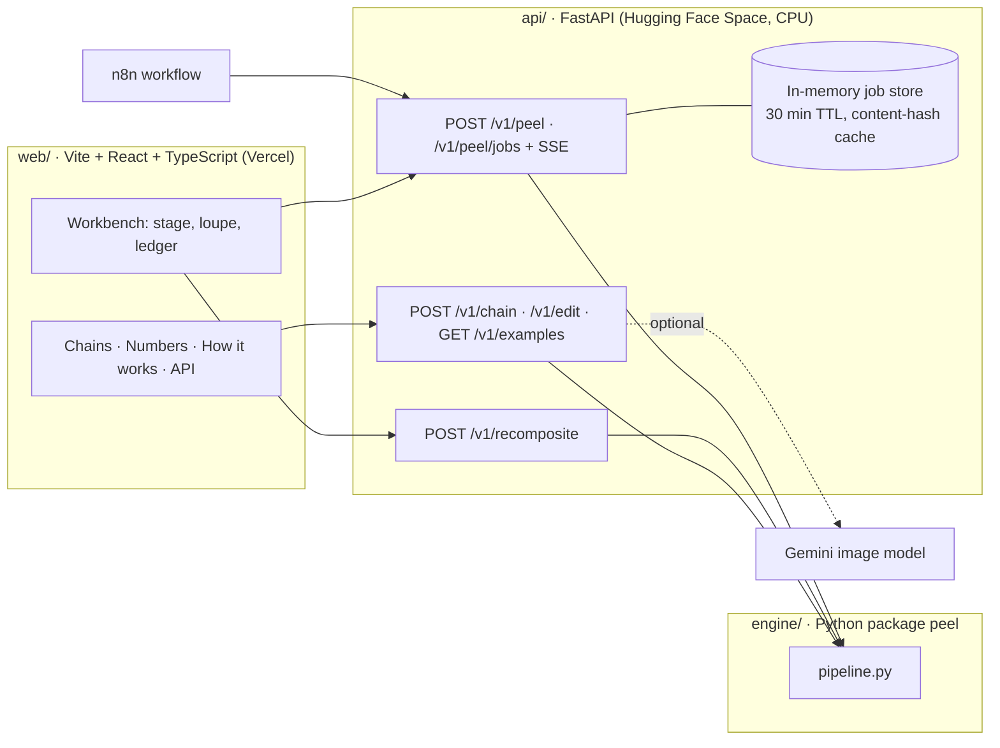
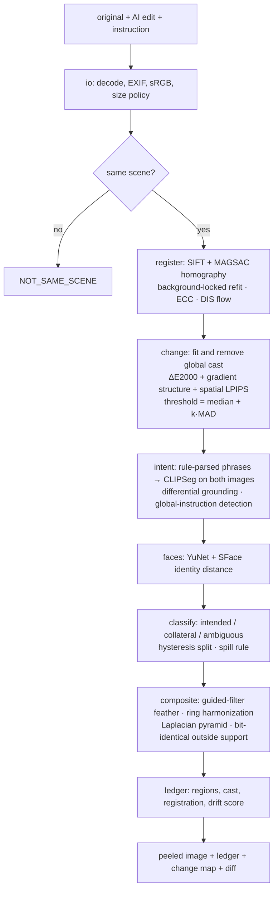

# Architecture

Peel is three small parts with one contract between them.

The contract is `engine/peel/types.py` (pydantic), re-exported by `api/app/schemas.py`, exported to
`api/openapi.json`, and compiled to `web/src/api/types.ts`. `make openapi` regenerates the chain.

## Engine pipeline

Analysis runs at a long side of 768 px. Compositing runs at full resolution (cap 4096 px) on the
bounding box of the kept regions only.

### Decisions that are not obvious

- **Identity is the null hypothesis for alignment.** A transform is only applied if it lowers the
  high-pass residual on the background. On smooth scenes a confident-looking fit can otherwise
  invent a shift, and a brightness change can be "explained" by sliding along a gradient.
- **The cast is fitted as an affine Lab transform but removed from kept pixels as a mean shift.**
  The affine fit is right for the colours it was fitted on (the background) and wrong for new
  content: extrapolating it turned a red apple orange.
- **Differential grounding.** A phrase for something added must light up in the edit and not in the
  original (and the reverse for something removed). Without this, "red ball" also selects a red
  jacket that was there all along.
- **The change threshold adapts to the pair.** Real AI edits re-render every pixel, so the noise
  floor is never zero. Regions are what stands out from that floor; the diffuse rest is reverted by
  compositing and summarized by the drift score.
- **Bit-identical by construction.** The blend is computed on a crop, faded to exactly zero a fixed
  distance from the mask, and every pixel outside that support is copied from the original array.
  A unit test checks it, and the web loupe lets anyone check it.
- **Global instructions swap the roles.** For "make it night" the edit is the base and locked faces
  and text from the original are pasted back in.

## API

One worker process, one pipeline at a time (the target box has two vCPUs). Jobs live in a
byte-budgeted LRU with a 30-minute TTL; identical requests are answered from a SHA-256 content
hash. Progress is real: each pipeline stage emits an event that the web app receives over SSE.
Curated examples are permanent jobs loaded from disk, so they are served without compute and still
support region flipping (analysed lazily on first use, warmed in the background at start).

## Web

No UI kit and no CSS framework. The first view is served entirely from static assets bundled with
the build, so the demo does not depend on the API being awake. See `web/DESIGN.md`.
